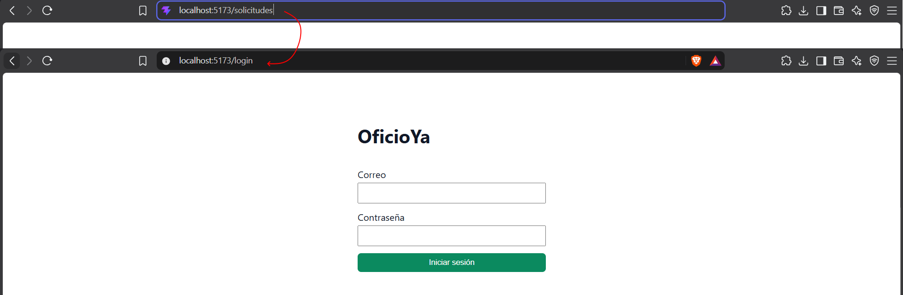
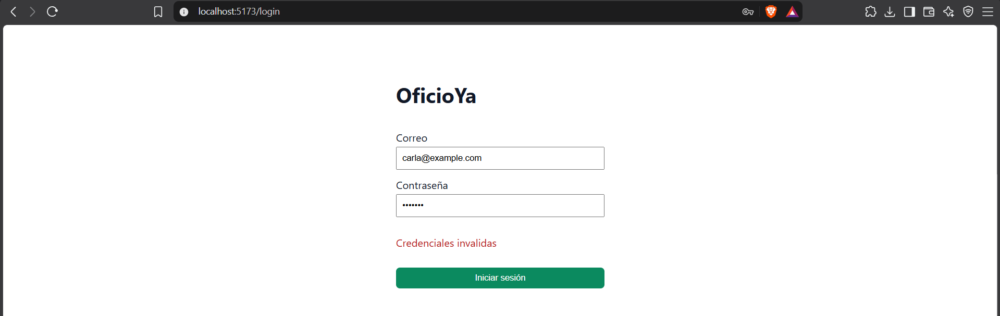
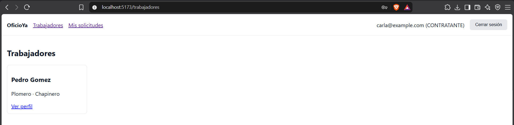
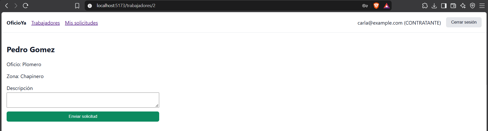
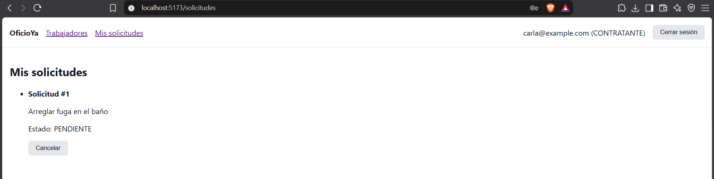
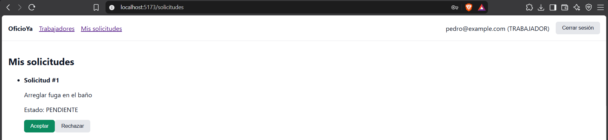
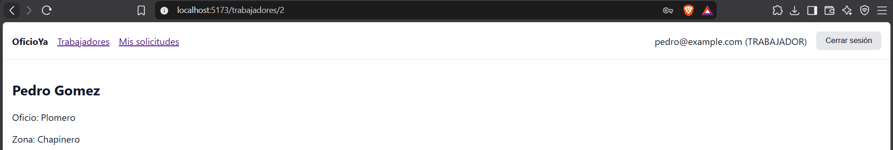
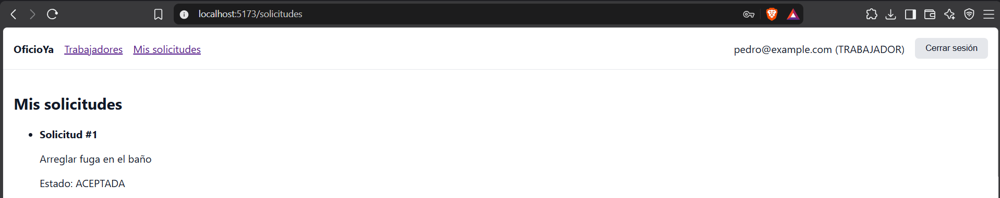
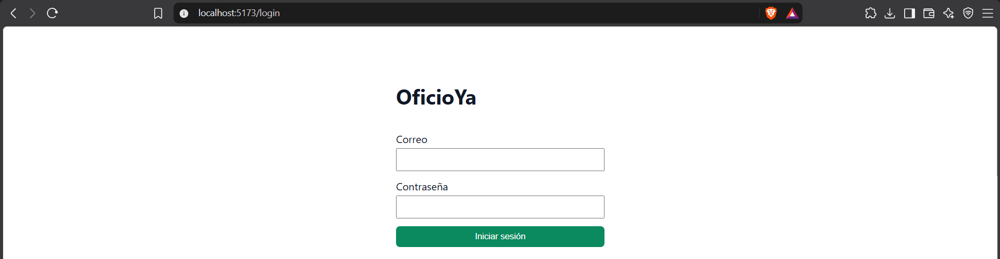
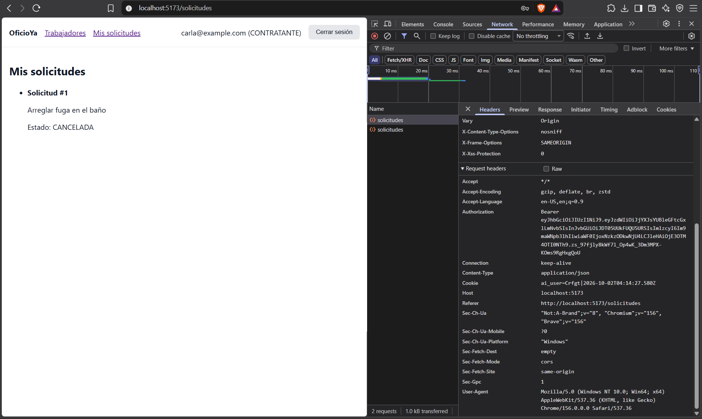

# DOSW - Laboratorio 9

Front de OficioYa hecho con React y Vite.

## Cómo ejecutarlo

Necesita el back corriendo en `http://localhost:8080`: [repositorio del back](https://github.com/DOrtizSalcedo/DOSW_Lab8_Sua_Ortiz_Duarte_Delgado/tree/develop).

```bash
npm install
npm run dev
```

La app queda en `http://localhost:5173`.

## Estructura

```text
src/modules/
├── core/            # Lo compartido: httpClient, Navbar, RutaProtegida, MensajeError y Boton
├── auth/            # Login y sesión (AuthContext, AuthProvider, useAuth)
├── trabajadores/    # Lista de trabajadores y perfil de cada uno
└── solicitudes/     # Mis solicitudes, nueva solicitud y acciones según el rol
```

## Evidencias

1. Sin sesión redirige al login: 
2. Contraseña errónea: 
3. Lista de trabajadores: 
4. Carla envía una solicitud:  
5. Pedro ve Aceptar y Rechazar, y no ve el formulario:  
6. Pedro acepta: 
7. Carla cancela: 
8. F5 vuelve al login: 
9. Encabezado Authorization: 

## Preguntas

### ¿Qué diferencia hay entre una prop y un estado (`useState`)?

Una prop es un dato que el componente recibe de su padre y no puede modificar. Un estado es un dato que el propio componente guarda y cambia, y cuando cambia el componente se vuelve a renderizar.

### ¿Por qué la carga de datos va dentro de `useEffect` y no directamente en el cuerpo del componente?

Porque el cuerpo del componente se ejecuta en cada renderizado. Si la petición estuviera ahí, al guardar la respuesta en el estado el componente se renderizaría otra vez y volvería a pedir los datos sin parar. Con useEffect la petición solo se repite cuando cambian sus dependencias, por ejemplo el id en el perfil del trabajador.

### ¿Para qué usaron `useContext` y qué pasaría si no lo usaran?

Para compartir la sesión (token, usuario, login y logout) con toda la app. Sin él habría que pasar el token como prop de componente en componente hasta llegar a cada pantalla.

### ¿Por qué ocultar el botón "Aceptar" a un contratante no es suficiente para proteger la API?

Porque ocultar un botón solo cambia lo que se ve en la pantalla. Cualquiera puede llamar al endpoint directamente con Postman o curl. La protección real está en el backend, que revisa el token y el rol en cada petición y responde 403 o 404 si no tiene permiso.

### ¿Qué ventajas tiene tener el front y el back en repositorios separados?

Cada uno tiene su propio historial y se puede cambiar y entregar sin afectar al otro. Solo se comunican por la API REST.